<!--
  Profil-README von the1leon98
  - Banner:      eigenes GIF (GitHub user-attachments)
  - Header:      assets/header.svg  (selbst gebaut, reines SVG + CSS)
  - Statistiken: profile/*.svg      (täglich per GitHub Action erzeugt,
                                     siehe .github/workflows/profile-cards.yml)
-->

  

  

## Über mich

- 🎓 **Azubi Fachinformatiker für Anwendungsentwicklung** am BBW Hamburg
- 🔐 Lerne **Ethical Hacking & Cybersecurity** – aktuell mit TryHackMe
- 🖥️ Betreibe einen eigenen **Homelab-Server** (Ubuntu Server, Docker, Tailscale)
- 🐧 Daily Driver: **Arch Linux + Hyprland**
- 🎮 Baue nebenbei ein **Motorsport-Management-Spiel** in Godot
- 🔧 Vorher Kfz-Ausbildung – jetzt schraube ich an Code statt an Motoren
<!-- - 🔭 Offen für ein Praktikum – gern remote. Schreib mich auf LinkedIn an! -->

## Tech-Stack

<table>
  <tr>
    <td><b>Sprachen</b></td>
    <td>
      
      
      
      
      
    </td>
  </tr>
  <tr>
    <td><b>Frameworks &amp; Tools</b></td>
    <td>
      
      
      
      
    </td>
  </tr>
  <tr>
    <td><b>Systeme &amp; Security</b></td>
    <td>
      
      
      
      
    </td>
  </tr>
</table>

## Ausgewählte Projekte

| Projekt | Worum es geht | Stack |
| --- | --- | --- |
| [**Homelab-Imperium**](https://github.com/the1leon98/Homelab-Imperium) | Self-hosted HomeOS-Dashboard für den Headless-Betrieb auf Ubuntu Server | Python · FastAPI · Docker · Vanilla JS |
| [**OSINT Recon Tool**](https://github.com/the1leon98/osint-recon-tool-bbw) | Automatisierte OSINT-Recherche mit KI-Risikoanalyse und druckbarem Report | Python · Rich CLI · HTML/CSS |
| [**Motorsport Manager**](https://github.com/the1leon98/motorsport-manager) | Management-Spiel mit tiefer technischer Fahrzeugsimulation | Godot · GDScript |

## GitHub-Statistiken

  
  

  <picture>
    <source media="(prefers-color-scheme: dark)" srcset="./profile/snake-dark.svg" />
    <source media="(prefers-color-scheme: light)" srcset="./profile/snake-light.svg" />
    
  </picture>

  Grafiken werden täglich per GitHub Action neu erzeugt.

