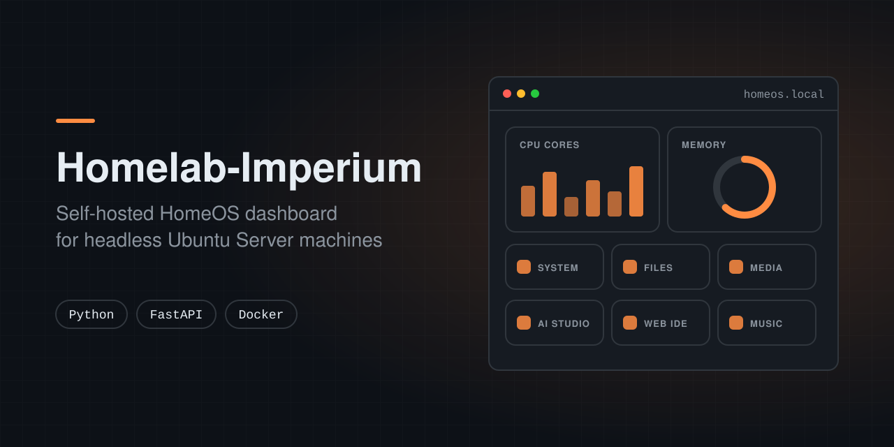
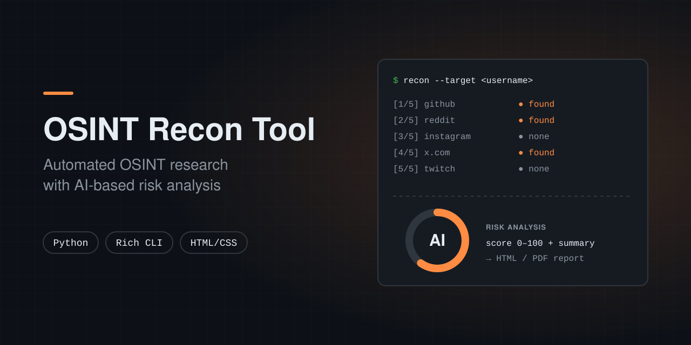

<!--
  Profile README of the1leon98
  - Banner:  custom GIF (GitHub user-attachments)
  - Header:  assets/header.svg  (hand-built, pure SVG + CSS – edit via scripts/make_header.py)
  - Covers:  assets/cover-*.svg (project covers – edit via scripts/make_covers.py)
  - Stats:   profile/*.svg      (regenerated daily by .github/workflows/profile-cards.yml)
-->

  

  

## About me

- 🎓 **Apprentice IT Specialist for Application Development** (German *Fachinformatiker*)
- 🔐 Learning **ethical hacking & cybersecurity**
- 🖥️ Running my own **homelab server** (Ubuntu Server, Docker, Tailscale)
- 🐧 Daily driver: **Arch Linux + Hyprland**
- 🔧 Former automotive mechanic apprentice – now I tune code instead of engines
<!-- - 🔭 Open to an internship – remote welcome. Reach out on LinkedIn! -->

## Tech stack

<table>
  <tr>
    <td><b>Languages</b></td>
    <td>
      
      
      
      
    </td>
  </tr>
  <tr>
    <td><b>Frameworks &amp; tools</b></td>
    <td>
      
      
      
    </td>
  </tr>
  <tr>
    <td><b>Systems</b></td>
    <td>
      
      
      
    </td>
  </tr>
</table>

## Featured projects

<table>
  <tr>
    <td width="50%" valign="top">
      
      <h3>Homelab-Imperium</h3>
      
Self-hosted HomeOS dashboard for headless Ubuntu Server machines. A FastAPI backend manages containers, system metrics and files behind a lightweight vanilla JS frontend.

      

        
        
        
        
      

      
    </td>
    <td width="50%" valign="top">
      
      <h3>OSINT Recon Tool</h3>
      
Automated OSINT research: checks usernames across platforms, runs an AI-based risk analysis and generates a printable HTML/PDF security report.

      

        
        
        
      

      
    </td>
  </tr>
</table>

## GitHub stats

  
  

  <picture>
    <source media="(prefers-color-scheme: dark)" srcset="./profile/snake-dark.svg" />
    <source media="(prefers-color-scheme: light)" srcset="./profile/snake-light.svg" />
    
  </picture>

  Graphics are regenerated daily by a GitHub Action.

